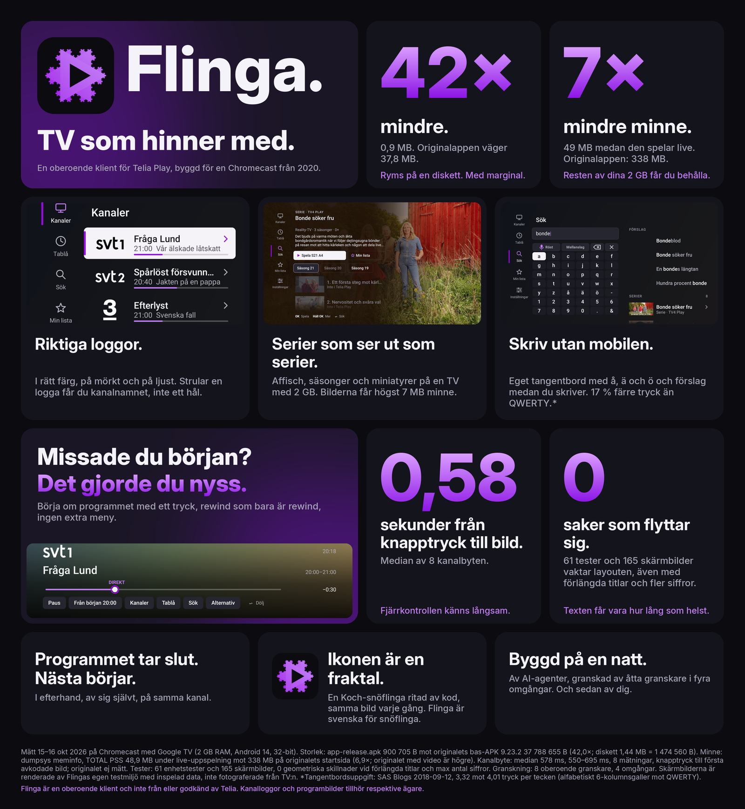
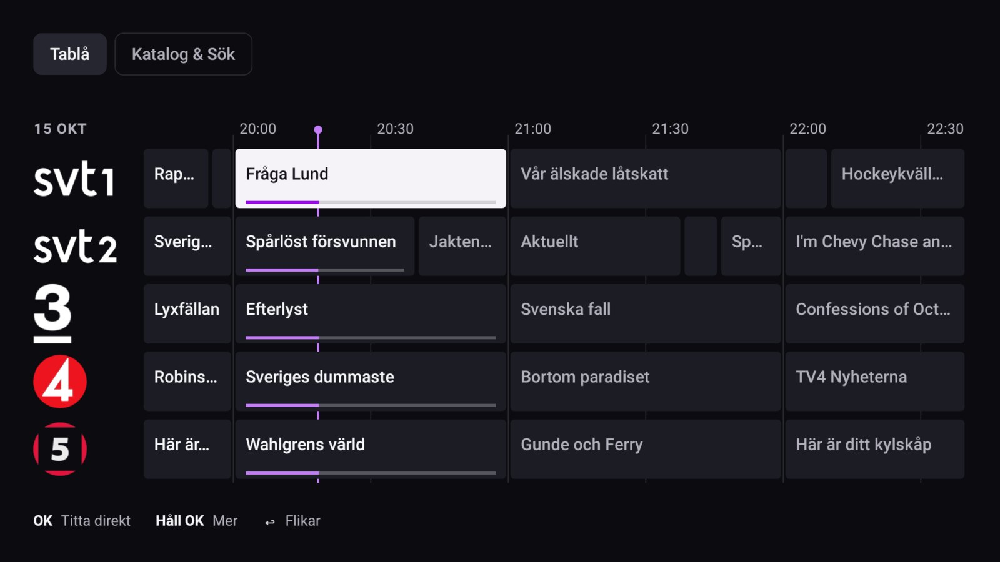
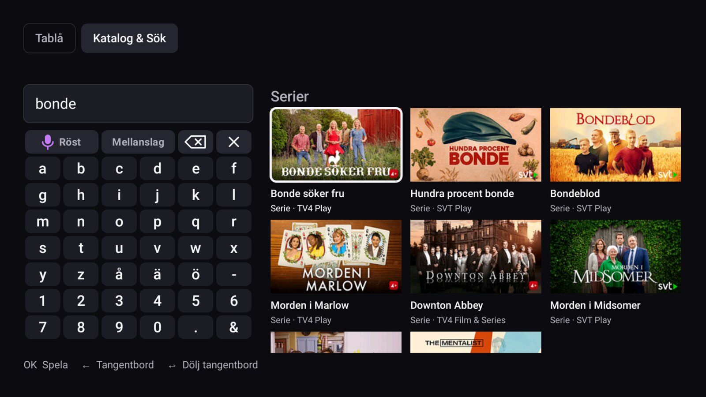
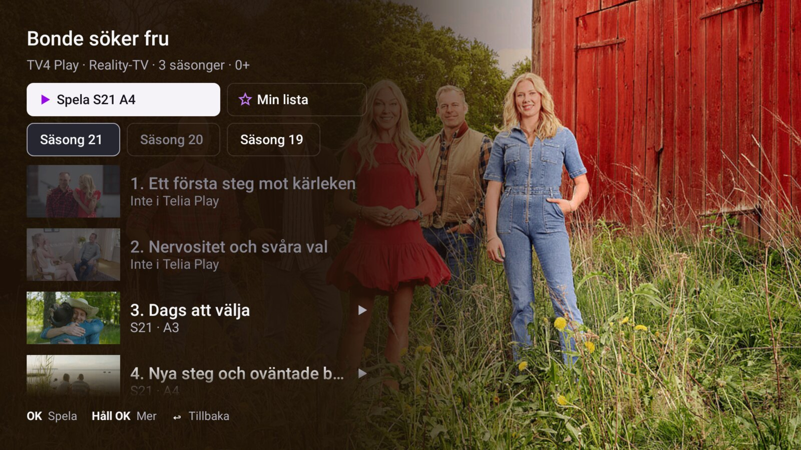
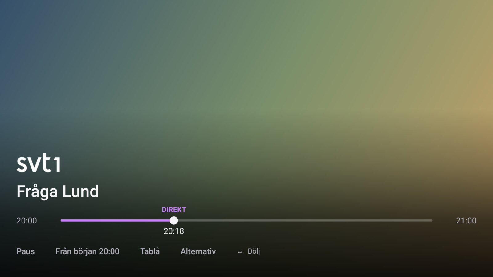
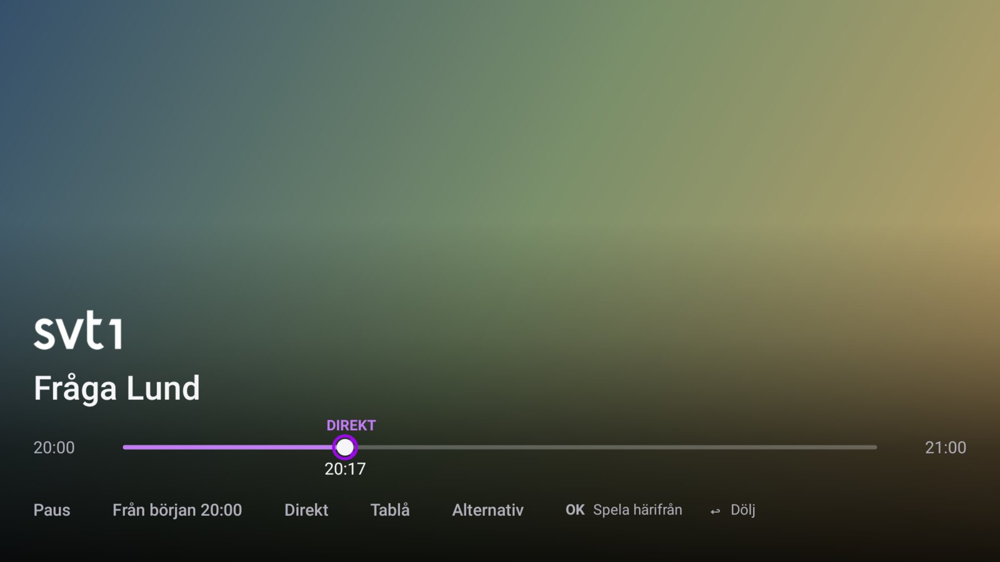
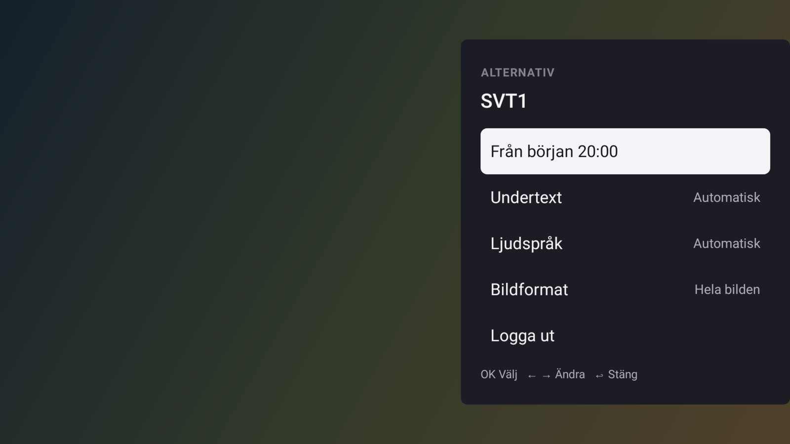

# Flinga

**TV som hinner med.** An independent Android TV client for Telia Play, built for a Chromecast
from 2020. Live TV, catch-up, search, series, recordings — the whole service in 0.9 MB, against
the official app's 37.8 MB, with a median 0.58 s from key press to first decoded picture.

<p align="center">
  
</p>

## Screenshots

Rendered offline by the test harness at 1920×1080 (the video behind the strip is a stand-in gradient).

| | |
|---|---|
|  |  |
| **Tablå**: the whole guide at once. OK plays, held OK opens the picker. | **Katalog & Sök**: an in-app keyboard with å, ä, ö on one grid. |
|  |  |
| **Serie**: key art, season chips and episode thumbnails. | **Live**: one strip for every kind of playback. |
|  |  |
| **Scrubbing**: ← → move along the channel's timeline, across programme edges. | **Alternativ**: one picker sheet for options. |

## Why

The official Telia Play app takes 2.7 s to start and holds 338 MB of memory on the target
device, a Chromecast with Google TV (2 GB RAM). Flinga starts in 0.43 s, plays live at 49 MB
PSS, and puts the whole client inside 1 MB — it would fit on a floppy disk, with margin.

It is built from a static analysis of the official app's API (version 9.23.2) and adds things
the official app does not do: a programme ends and the next one on the same channel starts, a
rewind crosses programme boundaries, the guide shows every channel at once, and the remote's
keys do what they should without menus in between.

| | Flinga | Official app |
|---|---|---|
| APK size | 0.9 MB | 37.8 MB |
| Memory, playing live | 49 MB PSS | 338 MB |
| Start to first picture | 0.43 s | 2.7 s |
| Key press to first decoded picture (zap) | 0.58 s median | not measured |

Measured 15–16 Oct 2026 on the target device (Android 14, 32-bit).

## What it does

- **Live TV** with instant zapping (bursts of ↑↓ coalesce into one tune), real channel logos
  in dark and light variants, and a pause that switches invisibly into the start-over stream.
- **Tablå and Katalog & Sök** in one browser. Tablå is the full-screen guide grid — every channel a
  row, time as columns, OK plays, held OK opens the picker, OK on the Tablå tab returns to now, and the playing picture stays as a small chip in the corner. The Katalog
  lens holds Fortsätt titta, the channels' programmes on air and the search results as fixed 16:9
  poster cards, with the query field and the in-app keyboard. Guides are fetched for the visible rows
  and cached with a TTL, so a day-old Tablå refetches instead of drawing blank.
- **One timeline per channel**: ← → move a cursor along the channel's broadcast time, across
  programme edges, whether the picture is live, start-over or catch-up. The strip shows the
  programme the cursor is in at once; the stream that holds the moment loads when the keys stop
  (a seek inside the stream that plays, else that programme's catch-up or start-over). A neighbour
  with nothing to play stops the cursor at the edge, and nothing passes live. Films and episodes
  seek inside their own stream.
- **Delayed channels continue themselves**: a catch-up or start-over programme that ends is
  followed by the next programme on the same channel, still delayed, until live is caught up.
- **Search** in the catalogue lens, with an on-screen keyboard (å, ä, ö on one grid, 17 % fewer
  presses than QWERTY) and Swedish voice input.
- **Serie pages** with key art, season chips and episode thumbnails inside a strict image
  budget (7 MB, released when the detail closes).
- **Fortsätt titta** is the catalogue's first shelf, read from Telia's own list; Nästa avsnitt
  offers the next episode with a countdown in the picker.
- **Android TV integration**: Watch Next rows on the home screen, `flinga://` deep links,
  voice search hand-off, a media session whose every callback is the same code the remote
  keys use, audio focus, frame-rate matching.
- **Skip intro/recap**: the playback ticket's `timeLine` (OPENING_CREDITS, CLOSING_CREDITS,
  RECAP) drives a "Hoppa över intro/recap" pill while the playhead is inside the span.
- **Recordings**: `play.npvr` is a catch-up fallback; `isRecordable` offers a record action.

## How it is built

- **One activity, three surfaces, platform views and Media3.** No Compose, no AndroidX UI — the
  guide grid, the bottom strip, the catalogue, the picker, the keyboard and every list are custom
  views drawn directly, so a focus move costs one redraw and nothing allocates per frame. The UX is
  the clean room of `docs/UX-CLEANROOM.md`: video with one strip, the browser (Tablå and Katalog &
  Sök), and one picker sheet. The rail and the panel are gone.
- **Offline-first development.** A Robolectric harness (`client/app/src/test`) replays recorded
  API fixtures, drives the real activity with synthetic key events, and renders 266 screenshots
  at 1920×1080. Every screenshot checks its geometry twice — once with the recorded data and
  once with stressed data (every title three times longer, three-digit channel numbers) — and
  fails when text length moves any rect. 38 test classes, 221 tests.
- **A design system first.** `client/design/DESIGN.md` is the spec; `REQUIREMENTS.md` holds
  every requirement with its verification evidence; the review rounds (R1–R4) are recorded
  with what failed and what changed.
- **Fixtures are recorded once** through the real API (`RecordFixtures`), with tokens and
  streaming tickets replaced by placeholders. The app itself keeps no credentials.

## Build and test

```sh
# build env (NixOS; pins the Android SDK, Gradle 8, JDK 17)
cd client && nix-shell ../shell.nix

# the full offline suite: unit tests, harness tours, 266 screenshots
gradle :app:testDebugUnitTest

# a single harness scenario
gradle :app:testDebugUnitTest --tests se.lite.play.Screens -Pscenario='key:DPAD_CENTER;shot:x'

# the release APK (signed with the local debug key, sideload build)
gradle :app:assembleRelease
```

Install on a TV: `adb install -r client/app/build/outputs/apk/release/app-release.apk`.

## Status

Built and used daily on the target TV. Verified on the device: login, live TV, zapping,
start-over, catch-up, seeking, delayed continuation. Offline-verified only (the TV settles
the rest): Watch Next rows, voice search hand-off, subtitle drawing. The requirement table
in [REQUIREMENTS.md](REQUIREMENTS.md) tracks every feature and its evidence.

## Project layout

```
client/app/src/main/java/se/lite/play/   the client (one MainActivity, Api, the custom views)
client/app/src/test/                     the offline harness (fixtures, tours, screenshot checks)
client/design/                           the design system, UX model, review rounds, TV checklist
client/fixtures/                         recorded API responses (the replay)
branding/                                the Flinga name study, icons, pitch poster
REQUIREMENTS.md                          every requirement with its evidence
docs/                                    ideas, parked plans
apk/                                     the official APK's decompile (local only, untracked)
```

## Name and icon

Flinga is Swedish for flake (as in snowflake) — something tiny and light. The icon is a Koch
snowflake with a play triangle, drawn by code, the same image every time. The name study,
including rejected candidates and their clashes, is in [branding/NAME.md](branding/NAME.md).

## Licence and scope

The code is MIT licensed, see [LICENSE](LICENSE).

Flinga is an independent client, not made by, from or approved by Telia, and it needs your own
Telia Play subscription. It contains no Telia code, credentials or streams: the app logs in with
your account on first start, and the official app's decompile (`apk/`) stays local and untracked.
The recorded API responses, channel logos and programme images under `client/fixtures/` are test
data from the service, kept so that the offline harness can replay it. They belong to their
respective owners; if you are one and want something removed, open an issue.
